  
  &nbsp;&nbsp;
  
  &nbsp;&nbsp;
  

  
  &nbsp;&nbsp;
  
  &nbsp;&nbsp;
  

---

 

<h2 align="center"> <code>cat about_me.txt</code></h2>

 

---

 

<h2 align="center">⚙️ <code>ls technical_skills/</code></h2>

<h3 align="center">🔎 Security Operations & Threat Hunting</h3>

<h3 align="center">🌐 Network Security</h3>

<h3 align="center">🖥️ Systems Administration</h3>

<h3 align="center">🛡️ Vulnerability Management</h3>

<h3 align="center">💻 Programming & Databases</h3>

 

---

 

<h2 align="center">📁 <code>./run portfolio.sh</code></h2>

Dedicated cybersecurity portfolio featuring hands-on projects focused on 
network traffic analysis, reconnaissance detection, DNS investigation, and SOC operations.

  

 

<table align="center">
  <tr>
    <td align="center" width="50%">
      <h3>📡 Nmap Network Scan Analysis</h3>
      

        Network reconnaissance and TCP traffic analysis using 
        Nmap and Wireshark.
      

    </td>
    <td align="center" width="50%">
      <h3>🌐 DNS Traffic Investigation</h3>
      

        DNS query and response analysis using Wireshark 
        from a defensive security perspective.
      

    </td>
  </tr>
  <tr>
    <td colspan="2" align="center">
       
      <h3>🛡️ Microsoft Sentinel SOC Investigation Lab</h3>
      

        SIEM-based SOC investigation project using 
        Microsoft Sentinel, Azure, and KQL.
      

    </td>
  </tr>
</table>

 

---

 

<h2 align="center">🕵️ <code>tail -f soc_activity.log</code></h2>

Supervised practical experience analyzing security events and detections in a cybersecurity operations environment using <b>CrowdStrike Falcon</b> and <b>Next-Gen SIEM</b>.

- Reviewing security events and detections
- Analyzing Windows processes and executable paths
- Investigating Parent Process and Child Process relationships
- Reviewing Command Line activity
- Analyzing process trees to understand execution chains
- Investigating suspicious PowerShell activity
- Reviewing detections involving malicious Office macros
- Analyzing potential security-control tampering activity
- Distinguishing legitimate activity from activity requiring further investigation
- Documenting technical findings and investigation steps

 

---

 

<h2 align="center">🎓 <code>cat certifications.txt</code></h2>

<table align="center">
<tr>
<td align="center"></td>
<td align="center"></td>
</tr>
<tr>
<td align="center"></td>
<td align="center"></td>
</tr>
<tr>
<td align="center"></td>
<td align="center"></td>
</tr>
<tr>
<td align="center"></td>
<td align="center"></td>
</tr>
</table>

 

---

 

<h2 align="center">📡 <code>echo $LEARNING_GOALS</code></h2>

 

---

 

<h2 align="center">📞 <code>connect --to juancarranza-cyber</code></h2>

  
  
  

# Juan José Carranza Marín

### Cybersecurity Analyst | Security Operations | Incident Investigation

**Microsoft Sentinel · KQL · CrowdStrike Falcon · Windows Security · Network Analysis**

Costa Rica | Open to SOC Analyst and Junior Cybersecurity Analyst opportunities

  
  
  

---

## Professional Profile

Cybersecurity professional with a **Bachelor's degree in Computer Security Engineering** and practical experience in security monitoring, event investigation, and defensive network analysis through hands-on projects and supervised exercises.

My work focuses on analyzing security telemetry, investigating suspicious activity, correlating events, and documenting technical findings. I have built a Microsoft Sentinel SOC laboratory with KQL-based investigations and detections, and completed network traffic analysis projects using Wireshark and Nmap.

I am pursuing opportunities in **Security Operations Centers (SOC), security monitoring, and entry-level incident investigation**.

## Featured Cybersecurity Projects

### 01. Microsoft Sentinel SOC Investigation Lab

**Focus:** SIEM operations, threat detection, log correlation, and incident investigation

A hands-on SOC environment connecting Windows endpoint telemetry to Microsoft Sentinel through Azure Arc, Azure Monitor Agent, and Log Analytics. The project documents investigations, analytics rules, alerts, and incident handling workflows.

**Selected work:**
- Investigated Windows authentication events **4625 and 4624** to correlate failed and successful sign-ins.
- Analyzed process creation events **4688** and Sysmon events **1, 3, and 11** to reconstruct process, network, and file activity.
- Developed and tested KQL-based detections for repeated failed logons and suspicious PowerShell activity.
- Documented detection validation, evidence collection, incident triage, and MITRE ATT&CK mapping.

**Technologies:** `Microsoft Sentinel` `Microsoft Azure` `KQL` `Sysmon` `Windows Event Logs` `MITRE ATT&CK`

[View Sentinel SOC Lab](https://github.com/juancarranza-cyber/SOC-Sentinel-Lab)

### 02. Nmap Network Scan Analysis

**Focus:** Network reconnaissance detection and TCP traffic analysis

A controlled network analysis project examining Nmap scanning activity through Wireshark packet captures. The investigation explores connection attempts, TCP flags, and traffic patterns relevant to identifying reconnaissance behavior.

**Technologies:** `Nmap` `Wireshark` `TCP/IP` `Kali Linux`

[View Nmap Investigation](https://github.com/juancarranza-cyber/nmap-network-scan-analysis)

### 03. DNS Traffic Investigation with Wireshark

**Focus:** DNS monitoring and network investigation

A packet-level investigation of DNS queries and responses, focused on understanding domain resolution, network communications, and the role of DNS evidence in defensive security analysis.

**Technologies:** `Wireshark` `DNS` `TCP/IP` `Packet Analysis`

[View DNS Investigation](https://github.com/juancarranza-cyber/DNS-Traffic-Investigation-Wireshark)

**[Explore the complete cybersecurity portfolio](https://github.com/juancarranza-cyber/Cybersecurity-Portfolio)**

## Practical Security Operations Experience

Through **supervised practical exercises**, I have analyzed security detections and endpoint activity using **CrowdStrike Falcon** and a next-generation SIEM environment.

Areas of practical exposure include:

- Reviewing security alerts and determining which activity requires further investigation.
- Analyzing Windows processes, executable paths, and command-line arguments.
- Reconstructing parent-child process relationships and execution chains.
- Investigating PowerShell activity, suspicious Office macro detections, and potential security-control tampering.
- Differentiating expected system behavior from potentially suspicious activity.
- Recording observations, technical evidence, and investigation steps.

## Technical Skills

| Area | Technologies and Skills |
| --- | --- |
| **Security Operations** | Alert triage, incident investigation, log analysis, security monitoring, threat hunting fundamentals |
| **SIEM and Endpoint Visibility** | Microsoft Sentinel, CrowdStrike Falcon, Windows Event Viewer, Sysmon, Azure Monitor |
| **Detection and Investigation** | KQL, Windows Security Events, process correlation, PowerShell analysis, MITRE ATT&CK |
| **Network Security** | Wireshark, Nmap, TCP/IP, DNS analysis, packet inspection, Cisco networking |
| **Operating Systems** | Windows, Linux, Kali Linux, Ubuntu |
| **Scripting and Tools** | Python fundamentals, Bash fundamentals, PowerShell, Git, GitHub |

## Education

**Bachelor's Degree in Computer Security Engineering**

Academic background in cybersecurity, computer systems, networking, and information security.

## Certifications and Technical Training

- Cisco CyberOps Associate
- Cisco Cybersecurity Essentials
- CCNA: Enterprise Networking, Security, and Automation
- CCNA: Switching, Routing, and Wireless Essentials
- CCNA: Introduction to Networks
- Python Essentials
- NDG Linux Essentials
- NDG Linux I

**Current professional development:** CompTIA Security+ preparation, security operations, and incident response.

## Contact

I am interested in entry-level cybersecurity opportunities where I can contribute to security monitoring, detection analysis, and incident investigation while continuing to develop my technical skills.

**LinkedIn:** [linkedin.com/in/juanjosecarranzamarin](https://www.linkedin.com/in/juanjosecarranzamarin)  
**Email:** [juanjosecm2005@gmail.com](mailto:juanjosecm2005@gmail.com)  
**GitHub:** [github.com/juancarranza-cyber](https://github.com/juancarranza-cyber)

